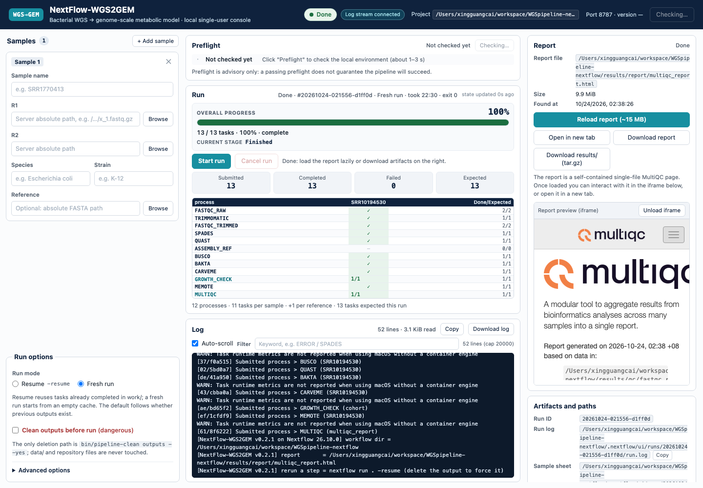

# 本地 Web UI（roadmap C）— 设计与契约

状态:**已实现并完成验收**(0.3.0:英文界面 + 总进度条 + 状态刷新兜底);真实 2 样本全流程在 2026-10-24 跑通(26/26、报告/下载逐字节一致),≤45 min 计时项因主机条件未达成、保留为待复测项(见 §14)。本文件是前后端并行开发的**唯一契约**;
实现者先读完本文件再写代码,契约有变更必须先改本文件并在任务板上通知另一端。

定位:**本地单用户 Web UI**,不是公网服务。浏览器打开 `http://127.0.0.1:<port>`,
单进程、单任务、零第三方依赖(仅 Python 3 标准库 + 原生 JS),离线可用。
roadmap C 的"不是公网服务"是定位决定,不是技术遗漏。

非目标:账号、多用户、配额、HPC、云端、多引擎、浏览器上传、运行历史、重新实现
报告展示层、Electron/桌面壳。

---

## 1. 事实基线(实现时不要重新假设)

| 事实 | 值/位置 |
|---|---|
| 管线引擎 | `nextflow` 26.10.0,**不在非交互 PATH**;本机在 `~/miniforge3/envs/nextflow/bin/nextflow` |
| 单次运行 | 2 样本 = 26 个任务;全量约 38 min(附 loadavg 才可比,F42) |
| 报告 | `results/report/multiqc_report.html`,自包含单文件,约 15 MB,内嵌 MEMOTE/QUAST 的 `iframe srcdoc` |
| 样本表 | tab 分隔,必需 `sample/fq1/fq2`,可选 `species/strain/reference`;`fq` 以 `/` 开头即绝对路径([main.nf](../main.nf) 第 677 行) |
| 报告路径的机器出口 | 管线 `onComplete` 打印 `[NextFlow-WGS2GEM v0.2.0] report       = /abs/.../multiqc_report.html` |
| 进度出口 | **两处**：stdout 的 `[hash] Submitted process > NAME (tag)`（只报提交）+ `.nextflow.log` 的 `Task completed > TaskHandler[…; name: NAME (tag); status: COMPLETED; …]`（报完成/失败） |
| CI 覆盖层 | [tests/ci/ci.config](../tests/ci/ci.config) 把全部输出重定向到 `tests/ci/out`,关 conda,`resourceLimits=[cpus:1]`;`report{}` 在解析期钉死,CI 里直接 disable → **UI 不能依赖它** |
| 破坏面 | UI 不删任何东西;删除只经 [bin/pipeline-clean](../bin/pipeline-clean)(默认档不删) |
| 测试铁律 | 不得写真实 `results/` 树(F18);`tests/ci/*.sh` 是唯一测试入口,CI 调同一脚本 |

### 进度与报告路径契约（实现必须同时读两处）

真实 Nextflow 26.10.0 的 **stdout 只打印提交**，任务完成写在项目根的 `.nextflow.log`
（DEBUG 行）；报告路径在 `onComplete` 的日志行里：

```
[<hash>] Submitted process > NAME (tag)                      # stdout（引擎日志里也有 INFO 版）
… DEBUG … Task completed > TaskHandler[id: N; name: NAME (tag); status: COMPLETED; exit: 0; error: -; workDir: …]
[NextFlow-WGS2GEM v0.2.0] report       = /abs/…/multiqc_report.html
```

- 完成计数与阶梯以 `.nextflow.log` 的 `Task completed` 行为准：fresh 运行从**启动时该文件的末尾**开始
  （不继承上一次运行的完成行）；一旦检测到 inode 变化或文件截断（Nextflow 启动时会把
  `.nextflow.log` 轮转为 `.nextflow.log.1`）就从 0 重读；attach / 终态恢复从 0 重放。
- `Completed process >` 行同样接受，供假引擎与旧版引擎使用；**两种来源都要有测试**（D47/F48 的教训：
  替身比真引擎更话痨时，测试会替真实行为背锅）。
- 报告路径取最后一条 `] report = …`（stdout 或引擎日志均可），再按 §9 回退。
- 这些文本行是**契约**，由 `tests/ci/run-ui-check.sh` 钉住；Nextflow 升级若改变格式，必须让测试
  显式失败，而不是让界面安静地显示"0 完成"。

---

## 2. 进程模型与文件布局

```
浏览器 (127.0.0.1)
  │  HTTP + SSE
  ▼
bin/pipeline-ui ──> python3 ui/server.py       单实例(fcntl.flock)
                       │ 状态机 / SSE / tailer / 预检
                       │ subprocess(start_new_session=True, cwd=<project>,
                       │            stdout+stderr → runs/<id>/run.log)
                       ▼
                    <nextflow> run . --samples_tsv .nextflow/ui/runs/<id>/samples.tsv ...
                       └─ conda 环境 → results/   (原样,UI 不碰)
```

| 新增文件 | 职责 | 写域 |
|---|---|---|
| `ui/server.py` | HTTP 路由、鉴权、SSE、静态文件、启动/取消/下载 | 后端 |
| `ui/runner.py` | 状态机、命令构造、日志契约解析、报告定位、attach/stale | 后端 |
| `ui/sheet.py` | 表单校验 → `samples.tsv` 落盘 | 后端 |
| `bin/pipeline-ui` | 启动器:找 python3/nextflow、选端口、单实例、开浏览器 | 后端 |
| `ui/index.html` `ui/app.js` `ui/style.css` | 单页界面,无外链资源 | 前端 |
| `tests/ci/run-ui-check.sh` | 断言 | 测试 |
| `tests/ci/fixtures/ui/fake-nextflow` | 可编程假引擎(契约的可执行版本) | 已由 Lead 提供,测试可扩展 |
| `docs/ui.md` | 本文件 | Lead |

运行期目录(全部 git-ignored):

```
.nextflow/ui/
├── server.lock           # flock,单实例
├── server.json           # {port,url,token,pid,started_at}
├── state.json            # 当前/上一次运行(见 §4)
└── runs/<run_id>/
    ├── samples.tsv       # UI 生成的样本表(不改仓库根上的 tracked samples.tsv)
    ├── run.log           # 子进程 stdout+stderr,追加写,UI 重启后可 attach
    └── meta.json         # 运行元数据(同 state.json 的 run 字段)
```

与 `pipeline-clean` 的关系:`outputs` 档只删 `.nextflow/{history,cache}` 与 `logs/` 等,
**不删 `.nextflow/ui/`**(不在允许清单内,且允许清单之外删不到);`all` 档删整个
`.nextflow/`。因此 UI 的运行日志在"清空产物"后仍可查看,`all` 之后按 idle 处理。

---

## 3. 启动器 `bin/pipeline-ui`

```bash
bin/pipeline-ui [选项]
  --project DIR       项目根,默认当前目录(必须含 main.nf + nextflow.config)
  --port N            默认 8787;被占用则自动 +1 试最多 20 个;0 = 系统分配
  --host IP           默认 127.0.0.1;非回环地址需显式传参,启动时打印警告
  --nextflow PATH     指定引擎;默认依次找 PATH、~/miniforge3/envs/nextflow/bin/nextflow
  --token TOK         固定 token(测试用);默认 secrets.token_urlsafe(16)
  --no-open           不自动开浏览器
  --print-url         启动成功后向 stdout 打印一行 `UI_READY {json}`,然后阻塞
  --nextflow-arg ARG  可重复;追加到 nextflow 命令行末尾(仅测试/高级使用)
  --help
```

行为:

1. 解析 python3(`sys.executable`)与 nextflow;找不到 nextflow **不阻止启动**
   (预检里报 fail,界面给出怎么装),但找不到 python3 直接退出。
2. `flock(.nextflow/ui/server.lock, LOCK_EX|LOCK_NB)`;已被占用则读 `server.json`
   打印 `UI_ALREADY_RUNNING {"url":...}` 并 exit 1。
3. 写 `server.json`;非 `--no-open` 且存在 `open` 时执行 `open <url>`。
4. 正常退出(SIGINT/SIGTERM)时:若有活动运行,先取消(见 §7.3)再退出,并释放锁、
   删除 `server.lock` 内容之外的 `server.json`? **保留** `server.json`(attach 需要),只清 pid 存活标记。

URL 形如 `http://127.0.0.1:8787/?token=<token>`。

---

## 4. 状态机

```
idle ──POST /api/run──> running ──┬─ exit 0 且找到报告 ──> done
                                  ├─ exit != 0 ─────────> failed
                                  ├─ 用户取消 ──────────> cancelled
                                  └─ 服务器重启且进程已死 ─> interrupted
done / failed / cancelled / interrupted ──POST /api/run──> running(新 run_id)
```

- `running` 期间再次 `POST /api/run` → **409**;`POST /api/cancel` 对 UI **拥有或 attach** 的
  运行有效(按 `state.json` 记录的 pid 进程组 kill;机器上不是 UI 启动的 nextflow 只检测、不杀)。
- **忙检测的判据(0.2.1/F50)**:只把"basename 恰为 `nextflow`/`fake-nextflow`(含 `sh -c` 包装)或
  JVM 带 `nextflow.cli.Launcher`/`nextflow.jar`/`-jar nextflow-*.jar`、**且 argv 含 `run`**"的进程算作引擎;
  `nextflow -version`/`config -flat` 天然不匹配。扫描排除本进程的**全部后代**与 `_run_cmd` 登记的存活子进程,
  所以页面自己的预检 JVM 不会把"开始运行"挡成 409;`409` 文案会带 pid 与命令行前 80 字符。
- 启动时读 `state.json`:state=running 且 pid 存活且 argv 里含 nextflow → **attach**
  (状态仍 running,从 `run.log` 头部重放解析);pid 已死 → `interrupted`,附原因
  "上次运行在 UI 退出后结束/被杀,请用 -resume 续跑"。
- 终止判定:`finished_at`、`exit_code`、`failed`、`report` 只在终态填写。
- **exit 0 + 找不到报告 = failed(reason=report_missing)**,绝不显示绿勾。

`state.json`(`run` 字段与 `GET /api/state` 的 `run` 同构):

```json
{
  "run": {
    "id": "20261023-215500-ab12cd",
    "state": "running",
    "mode": "resume",
    "clean_requested": false,
    "pid": 4567,
    "since_pid_alive": true,
    "started_at": 1761227700.0,
    "finished_at": null,
    "elapsed_seconds": 42.1,
    "exit_code": null,
    "cancel_requested": false,
    "sheet": "/abs/.nextflow/ui/runs/<id>/samples.tsv",
    "log": "/abs/.nextflow/ui/runs/<id>/run.log",
    "log_bytes": 123456,
    "samples": ["SRR1770413", "SRR10194530"],
    "argv": ["/path/nextflow", "run", ".", "--samples_tsv", "..."],
    "tasks": {"submitted": 5, "completed": 3, "failed": 0, "expected": 26},
    "steps": [
      {"process": "FASTQC_RAW", "expected": 4, "completed": 2, "running": 0, "failed": 0,
       "by_sample": {"SRR1770413": 2, "SRR10194530": 0}}
    ],
    "failed": null,
    "report": null
  }
}
```

终态时 `failed` 形如:

```json
{"process": "SPADES", "tag": "SRR10194530", "exit_code": 1,
 "reason": "task_failed", "work_dir": "/abs/work/ab/cdef01",
 "stderr_tail": "…最后 40 行…", "message": "SPADES 在样本 SRR10194530 上以退出码 1 失败"}
```

`report` 形如:

```json
{"path": "/abs/results/report/multiqc_report.html", "size": 15400000,
 "url": "/api/report", "found_at": 1761227700.0}
```

---

## 5. 每次运行的命令

```
<nextflow> run . --samples_tsv <sheet> [--report_tag <tag>] [-profile lowmem] [-resume] <--nextflow-arg...>
```

- `cwd = <project>`;`start_new_session=True`;`stdout=stderr=run.log`(追加、"a" 模式);
  **不用 shell**,argv 列表直传。
- `mode=fresh` 不带 `-resume`;`mode=resume` 带 `-resume`。
- `clean=true` 时,**在 spawn 之前**先跑
  `<project>/bin/pipeline-clean outputs --yes`(cwd=project),输出带
  `=== pipeline-clean outputs ===` 横幅追加进 `run.log`;非零退出 → 直接
  `failed(reason=clean_failed)`,不启动 nextflow。
- `--report_tag` 只允许 `^[A-Za-z0-9._-]+$`;空串不传。
- 环境继承 UI 进程;若 nextflow 是通过绝对路径解析到的,把其所在目录 **prepend 到
  PATH**(让同环境的 helper 可见),不改其它环境变量。
- 日志文件先写一行 `=== run <id>: <argv> ===` 便于取证。

**期望任务数**(仅用于进度分母,不用于判定成败):

```
expected = 11*N + refs + 2
  N      = 样本行数
  refs   = reference 非空的样本数(每个多一个 ASSEMBLY_REF)
  +2     = GROWTH_CHECK 1 + MULTIQC 1
```

实际提交数超过/落后于该值时照实显示,不修正、不隐藏。

---

## 6. 样本表契约(`ui/sheet.py`)

固定 6 列,顺序固定,LF 换行,末行有换行:

```
sample	fq1	fq2	species	strain	reference
```

校验规则(服务端为准,前端做同样的即时提示):

| 字段 | 规则 | 失败 code |
|---|---|---|
| sample | 非空;`^[A-Za-z0-9._-]+$`;不得为 `.` / `..`;同批唯一 | `empty` `invalid` `duplicate` |
| fq1/fq2 | 必填;必须是**绝对路径**;存在、是普通文件、可读、非空 | `required` `not_absolute` `not_found` `not_file` `unreadable` `empty_file` |
| fq2 | 不得与 fq1 相同 | `same_file` |
| reference | 可空;非空时同 fq 的路径规则 | 同上 |
| species/strain | 可空;不得含 tab/换行/回车 | `invalid_chars` |
| 整批 | 至少 1 个样本;样本名不得重复 | `no_samples` `duplicate` |

非 gzip 后缀只告警(`warn`),不阻断——管线自己会决定能不能处理。

错误响应:`400 {"error":"validation_failed","errors":[{"row":2,"field":"fq2",
"code":"not_found","message":"第 2 行 fq2 不存在: /abs/x.fastq.gz"}]}`。
**校验失败绝不 spawn 进程。**

---

## 7. HTTP API

通用:JSON UTF-8;`Cache-Control: no-store`;错误体 `{"error":"code","message":"...",
"detail":{...}}`;POST 只接受 `application/json`,请求体上限 1 MiB。

鉴权:

- `GET /?token=T` → 校验后 `Set-Cookie: ui_token=T; Path=/; HttpOnly; SameSite=Strict`,
  返回 `index.html`。缺 token 且无有效 cookie → 403 HTML 提示"请使用启动器打印的完整 URL"。
- `/api/*`:token 来自 cookie、`X-UI-Token` header 或 `?token=`,任一正确即可;否则 403。
- 若请求带 `Origin` 头,必须是 `http://127.0.0.1:<port>` 或 `http://localhost:<port>`,否则 403。
- 静态 `/app.js`、`/style.css` 不鉴权(同源加载,无敏感内容);路径白名单,拒绝 `..`。

| 方法/路径 | 说明 |
|---|---|
| `GET /` | 单页(需 token/cookie) |
| `GET /app.js` `GET /style.css` | 静态 |
| `GET /api/state` | `{"server":{...},"run":<run|null>}` |
| `GET /api/preflight` | 见 §7.1 |
| `GET /api/events?from=<byte>` | SSE,见 §8 |
| `POST /api/run` | 启动;body 见 §7.2;202 `{"run_id":...}`;400/409 |
| `POST /api/cancel` | 200 `{"cancel_requested":true}`;409 `{"error":"no_active_run"}` |
| `GET /api/fs?path=<abs>` | §7.3 目录浏览 |
| `GET /api/report` | 流式返回定位到的报告(`text/html`);404 `{"error":"no_report"}` |
| `GET /api/download?what=results\|report\|log` | §9 |

### 7.1 预检

`GET /api/preflight` 约 1–3 s。**预检只提示,不代替管线裁决**(F20 的判断仍由管线做)。

```json
{
  "ok": true,
  "checks": [
    {"id": "nextflow", "label": "Nextflow", "status": "ok", "detail": "26.10.0 (/path/nextflow)", "hint": ""},
    {"id": "java", "label": "Java 17+", "status": "ok", "detail": "openjdk 21", "hint": ""},
    {"id": "conda", "label": "conda / mamba", "status": "ok", "detail": "/path/mamba", "hint": ""},
    {"id": "bakta_db", "label": "Bakta db-light", "status": "ok", "detail": "version.json 存在", "hint": ""},
    {"id": "busco_db", "label": "BUSCO lineage", "status": "ok", "detail": "enterobacterales_odb10", "hint": ""},
    {"id": "conda_envs", "label": "conda 环境", "status": "warn", "detail": "0/8 已构建", "hint": "首次运行需构建 8 个环境(约 5.7 GiB,需网络),可能远超 45 分钟"},
    {"id": "disk", "label": "磁盘", "status": "ok", "detail": "27.1 GiB 可用 (需 ≥20)", "hint": ""},
    {"id": "external_nextflow", "label": "外部 nextflow 进程", "status": "ok", "detail": "无", "hint": ""}
  ],
  "summary": {"failures": 0, "warnings": 1},
  "disk": {"free_gb": 27.1, "required_gb": 20.0, "path": "/"},
  "config": {"source": "nextflow config -flat", "multiqc_dir": "/abs/results/report",
             "report_name": "multiqc_report", "min_free_disk_gb": 20,
             "raw_dir": "/abs/data/raw", "ref_dir": "/abs/data/reference"},
  "existing": {"results_bytes": 456000000,
               "report": {"path": "/abs/results/report/multiqc_report.html", "size": 15400000, "mtime": 1760000000.0},
               "conda_envs": 8, "work_bytes": 1400000000,
               "clean_plan": {"level": "outputs", "text": "…pipeline-clean check 输出…"}},
  "active_run": null
}
```

`config` 来源:启动时执行一次 `<nextflow> config -flat`(超时 15 s),容错解析
`params.<name> = <value>`;执行失败/超时/解析失败 → `source: "fallback"` + 内置默认
(`<project>/results/report`、`multiqc_report`、`20`、`<project>/data/raw|reference`),
并在 `checks` 里加一条 warn。**UI 不得解析 nextflow.config 文本来猜。**

### 7.2 `POST /api/run`

```json
{
  "samples": [
    {"name": "SRR1770413", "fq1": "/abs/r1.fastq.gz", "fq2": "/abs/r2.fastq.gz",
     "species": "Escherichia coli", "strain": "K-12", "reference": ""}
  ],
  "mode": "resume",
  "clean": false,
  "profile": "standard",
  "report_tag": ""
}
```

- `mode ∈ {fresh, resume}`;`profile ∈ {standard, lowmem}`;`clean` 布尔。
- 校验 → 写 sheet → (可选 clean) → spawn → 状态 `running` → 202。
- 运行中或外部 nextflow 存在 → 409 `{"error":"busy","message":"…","run":<run|null>}`。

### 7.3 `GET /api/fs`

只列**名字 + 大小**,不返回文件内容;不提供上传。

```json
{"path": "/abs/data/raw", "parent": "/abs/data", "home": "/Users/me",
 "shortcuts": [{"name": "raw", "path": "/abs/data/raw"}, {"name": "reference", "path": "/abs/data/reference"}],
 "dirs": [{"name": "sub", "path": "/abs/data/raw/sub"}],
 "files": [{"name": "a_1.fastq.gz", "path": "/abs/data/raw/a_1.fastq.gz", "size": 123456, "kind": "fastq"}]}
```

`kind ∈ {fastq, fasta, other}`;按后缀过滤 `*.fastq.gz|*.fq.gz|*.fastq|*.fq|*.fasta|*.fa|*.fna`。
非法路径 → 400 `{"error":"not_a_directory"}`;不跟随 symlink 出项目外?本地单用户,
允许浏览任意目录,但 `realpath` 后仍是目录才列。

---

## 8. SSE 协议

`GET /api/events?from=<byte>&token=<...>`(`text/event-stream; charset=utf-8`,
`Cache-Control: no-cache`)。

```
event: state
data: {"run": <run|null>}

event: log
data: {"from": 1234, "text": "…原样文本块…"}

: ping

```

- 连接时先发一条 `state`,然后从 `from`(缺省 0,或 `Last-Event-ID`)读 `run.log` 增量,
  每 250 ms 检查一次;进入终态后再发一条 `state` 并保持连接(心跳),浏览器可主动断开。
- 文本按 UTF-8 增量解码(不能把多字节字符切断),`json.dumps` 保证换行安全。
- 重连语义:`from` 之前的字节不重发;`run.log` 只追加不重写,故偏移量稳定。
- 心跳 15 s 一条注释行,防代理/浏览器超时。

---

## 9. 报告与下载

**报告定位**(顺序固定):

1. `run.log` 中最后一条 `] report\s+=\s+(/\S+\.html)` 命中的路径;
2. 否则 `<config.multiqc_dir>/<config.report_name>.html`;
3. 否则 glob `<project>/results/report/multiqc_report*.html`,取 mtime 最新;
4. 全部失败 → 终态 `failed(reason=report_missing)`,面板明说"跑完了但没找到报告"。

`GET /api/report`:流式 64 KiB 分块转发;`Content-Type: text/html; charset=utf-8`;
`X-UI-Report-Path: <abs>` 便于调试。

`GET /api/download`:

| what | 内容 | 响应 |
|---|---|---|
| `results` | results 根的流式 `tar.gz`(不落盘;不含 `.DS_Store`;符号链接按链接处理) | `application/gzip`,`Content-Disposition: attachment; filename="results-<stamp>.tar.gz"` |
| `report` | 报告单文件 | `text/html` 下载 |
| `log` | `run.log` | `text/plain` 下载 |

**results 根的推导**:报告路径为 `<results_root>/report/<name>.html` → 取
`<results_root>`;否则 `<project>/results`。这样 CI 覆盖层
(`tests/ci/out/results/...`)下也能下载正确的树。

---

## 10. 安全边界

- 只绑 `127.0.0.1`;`--host` 非回环时启动打印警告,界面顶部显示"局域网可访问"红条。
- 一次性 token + Origin 校验(本地 CSRF 防护);cookie `HttpOnly; SameSite=Strict`。
- 无上传接口;`/api/fs` 只列目录;所有路径参数 `realpath` 后校验。
- 不拼接 shell 字符串;子进程 argv 列表直传。
- 报告/下载只服务已定位的路径,不做通用静态文件服务。
- 日志内容原样转发,前端用 `textContent` 渲染(不 `innerHTML`),防注入。

---

## 11. 前端规格(`ui/index.html` / `app.js` / `style.css`)

单页、**英文**(2026-10-24 用户要求,0.3.0;API 的用户可见文案同样是英文)、离线
(禁止任何 `http(s)://` 外链:CSS/JS/字体/图片全部内联或本地)。DOM id / `data-*` 在 0.3.0 保持不变,
所以既有断言可平移。

**总进度条(0.3.0)**:运行卡片上部 `#overall-progress`(`role="progressbar"`,aria-valuemin/max/now),
百分比 = completed / expected(clamp 0–100;done 强制 100),caption 形如 `17 / 26 tasks · 65% · 2 running`;
配 `CURRENT STAGE` 行、终态配色(done 绿 / failed 红 / cancelled 灰)与 `state updated Ns ago` 小字。
原 12 阶段阶梯与四个计数保留,两者不互相替代。

**刷新兜底(0.3.0,F51)**:主通道仍是 SSE,但 `state` 事件现在在**进度摘要**
(submitted/completed/failed)变化时也会推送;页面可见时每 5 s 轮询 `/api/state`,hidden 暂停,
`visibilitychange`/`focus` 立即刷新;SSE state 进入终态后 600 ms 再拉一次;45 s 没有事件则看门狗重连。
"任务结束后运行模块不更新、后台标签页回来还是旧状态"由此不再依赖单条长连接。
不使用框架与构建步骤;`app.js` 必须能被 `node --check` 解析。

布局(桌面优先,≥1280px 三栏;窄屏纵向堆叠):

```
┌ 顶栏:标题 · 状态徽章 · 项目路径 · [预检] · 端口/版本 ────────────────┐
├ 左栏(输入) ───────────────┬ 中栏(运行) ─────────────┬ 右栏(结果) ──┤
│ 样本卡片列表(可增删)      │ 预检清单(✓/⚠/✗ + hint)  │ 报告 tab     │
│  样本名 / R1[浏览] / R2    │ [开始运行] [取消]        │  iframe(懒)│
│  物种 / 菌株 / 参考[浏览]  │ 阶段阶梯:12 个 process  │ 下载 results │
│ 运行模式:⦿续跑 ○全新运行  │   × N 样本的完成格        │ 下载报告     │
│  □ 运行前清空产物(危险)   │ 计数:已提交/完成/失败     │ trace/report │
│ 高级:profile / report_tag │ 日志终端(搜索/自动滚动)   │ 路径/大小    │
└───────────────────────────┴──────────────────────────┴──────────────┘
失败面板(终态 failed 时置顶):✗ 步骤 / 样本 / exit code / stderr 尾 / work 目录 / [续跑重试]
```

关键交互:

1. 进页面先 `GET /api/state` + `GET /api/preflight`;状态 `running` 时恢复日志流。
2. **[浏览]** 打开服务端目录选择器(`/api/fs`),起点 `data/raw`(FASTQ)与
   `data/reference`(参考);可手动输入绝对路径。**不上传、不复制文件**。
3. 表单草稿存 `localStorage`(刷新不丢);样本名默认取 R1 文件名去掉 `_1/_R1` 后缀。
4. 运行模式默认 `resume`(有历史产物)/ `fresh`(无历史产物);勾选"清空产物"时,
   把 `pipeline-clean check` 的将删清单展示出来并要求二次确认。
5. 日志:自动滚动开关、关键字过滤(客户端)、复制、下载;错误行(`ERROR|Caused by|FAIL`)
   标红;行数上限 20000 后丢弃最旧的(保留文件,仅 UI 限流)。
6. 终态:`done` 显示报告按钮并懒加载 iframe(15 MB,首次点击再加载);`failed` 置顶错误面板;
   `cancelled` 显示"已取消,work/ 保留,可续跑";`interrupted` 同 failed 但原因不同。
7. 运行中禁止改表单 / 开始按钮 disabled / 取消按钮二次确认。
8. `GET /api/state` 与 SSE 的 `state` 事件都用于渲染;前端不做状态推断。

---

## 12. UI-D 决策(每条:决定 / 理由 / 代价)

| 编号 | 决定 | 理由 | 代价 |
|---|---|---|---|
| UI-D1 | 样本表写 `.nextflow/ui/runs/<id>/samples.tsv`,不改仓库根 `samples.tsv`;FASTQ 用绝对路径 | `samples.tsv` 是 tracked 文件;绝对路径避免复制 | `data/raw` 只作浏览默认起点 |
| UI-D2 | UI 不自己删任何东西;唯一删除入口是 `bin/pipeline-clean outputs --yes`(显式勾选) | 仓库已把删除做成允许清单+复核+盘点 | MVP 无"只重建报告"按钮(文档给命令) |
| UI-D3 | 报告路径从 `onComplete` 日志行解析,兜底 config/glob | CI 覆盖层重定向输出,硬编码必然测不了;契约可用测试钉住 | 依赖一行日志文本,故有断言 + 显式失败 |
| UI-D4 | 日志落盘,SSE 从文件 tail,支持 refresh/attach | 刷新、断线、UI 重启不丢日志 | 多一个 tailer 线程与偏移量 |
| UI-D5 | 进度 = 阶段阶梯 + 任务计数,不显示假百分比 | 宁缺勿假 | 界面略朴素 |
| UI-D6 | 失败 = 步骤/样本/退出码/stderr 尾/work 目录;报告缺失也判 failed | roadmap 明确不要白屏或绿勾 | 需解析引擎错误块 |
| UI-D7 | 取消 = SIGTERM 进程组 → 10 s → SIGKILL;cancelled ≠ failed;保留 work/;UI 重启 attach 后同样可取消(按记录的 pid 进程组,无 Popen 句柄时 exit_code 为 null) | 取消后必须能 `-resume` 续跑;长跑中途重启 UI 仍要能停 | 少数子进程可能需 SIGKILL |
| UI-D8 | 报告用 iframe 直连,不复刻展示层 | 报告已自包含 15 MB | 首屏 15 MB,故懒加载 |
| UI-D9 | 下载流式 tar.gz,不落盘 | 435 MB 不能进内存 | 无断点续传 |
| UI-D10 | 127.0.0.1 + 一次性 token + Origin 校验 | 防任意网页 POST localhost | 换端口/重启需重开链接 |
| UI-D11 | 预检只提示,不复制 F20 裁决 | 两套规则必然漂移 | 预检通过 ≠ 管线一定开跑 |
| UI-D12 | 单实例 flock + 单任务 + 检测外部 nextflow | 与"单一输出根"一致 | 不能排队(明确不做) |

---

## 13. 测试钩子与断言(给测试任务)

工具无关为主:用 `tests/ci/fixtures/ui/fake-nextflow` 当引擎(`--nextflow <fake>`,
`FAKE_NEXTFLOW_CTRL` 指向控制文件),每个场景重写控制文件即可,无需重启 UI。

控制文件:`{"mode":"success|fail|slow|noreport","delay":0.02,
"fail_process":"SPADES","fail_sample":"<sample>","report":"<abs path>",
"config":"ok|fail","version":"26.10.0"}`。

断言清单(至少):

1. 启动 `--print-url` 输出 `UI_READY`,URL 可访问;`GET /` 200、英文页面(`<html lang="en">`、英文 title);
2. `GET /` 无 token 且无 cookie → 403;带 `?token=` → 200 + `Set-Cookie`;
3. `index.html`/`app.js`/`style.css` 中无 `http://`/`https://` 外链;`node --check ui/app.js` 通过;
4. `GET /api/preflight` 返回 checks;nextflow 缺失(`--nextflow /nonexistent`)→ fail 且不崩;
5. 校验:缺 fq2 / 相对路径 / 不存在 / 重复样本名 / 非法字符 → 400 带 row+field,
   **且 `state.run` 仍为 null、未 spawn**(负对照);
6. 成功:`samples.tsv` 内容逐字节正确(表头、tab、绝对路径、空 reference、末行换行);
7. 运行中第二次 `POST /api/run` → 409;
8. SSE:收到 `Submitted/Completed` 行与 state 变化;`from=<offset>` 重放不重复;
   **完成计数在"引擎只写 `.nextflow.log`、stdout 无 Completed 行"的模式下也正确**(fake 的 engine_log 模式);
   真实 stub 全 DAG 的 `done` 状态里 `tasks.completed == 25`;
9. `done` 后 `/api/report` 200 且字节等于 fake 写的报告;`/api/download?what=results`
   解包后文件清单与 fake 结果树一致;`?what=report|log` 各自正确;
10. `failed`(fake mode=fail)→ 状态 failed;`failed.process/tag/exit_code/stderr_tail`
    正确;错误面板字段可由 `/api/state` 得到;
11. `noreport`(exit 0 无报告)→ failed,reason=report_missing(**不是 done**);
12. 取消:slow 模式 → `POST /api/cancel` → 进程组消失、state=cancelled、`run.log` 保留;attach 场景(杀 UI 重启)同样取消成功;
13. 单实例:第二个 `bin/pipeline-ui` 退出码 1 且打印 `UI_ALREADY_RUNNING`;
14. stale:伪造 `state.json`(pid 不存在)→ 启动后 state=interrupted;
15. attach:运行中 kill UI 再启动 → state=running 且能继续读到日志(pid 存活时);
16. 鉴权:无 token POST → 403;`Origin: http://evil.example` → 403;
17. `--project` 指向副本时,仓库真实 `results/` 树 mtime 不变(F18);
18. 全部 HTTP 响应 `Cache-Control: no-store`(API)。
19. **0.3.0 新增**:`ui/*.html|js|css` 与 `ui/*.py` 的 CJK 字符数为 0;后端 403/400/preflight/failed 等
    用户可见文案全英文;页面含 `#overall-progress`/`role="progressbar"`/`aria-valuemin|max|now`,
    `app.js` 含百分比 clamp 与 `tasks.completed/expected` 渲染;`app.js` 含 `visibilitychange`、window
    `focus`、5 s `pollState` 轮询、45 s SSE watchdog、终态 600 ms 二次 `refreshState`。

真实集成(CI 有 nextflow 时):用 `--nextflow-arg=-c --nextflow-arg=tests/ci/ci.config
--nextflow-arg=-stub-run` 跑完整 DAG(约 8 s),断言 done、报告非空、任务计数 25;
可选:叠加 `-c tests/ci/inject-sample-failure.config` 验证真实失败解析(约 20 s)。

---

## 14. 验收口径与实测记录(2026-10-23)

### 14.1 计划口径

1. 环境已就绪(nextflow/mamba 可用、conda 环境已存在)前提下:选两个 FASTQ → 看见报告 ≤ 45 min;
   记录起止时间、`vm.loadavg`、`df`(否则不可比,F42)。
2. 报告未变:26 任务、MEMOTE 68.1/67.8、BUSCO 100%、报告 >15 MB、iframe 可渲染。
3. 注入失败:面板 2 s 内给出 步骤/样本/exit code/stderr 尾;`-resume` 可收敛。
4. 取消后 `work/` 保留、续跑收敛;435 MB 下载解包清单与 `results/` 一致。
5. 冷启动(conda 环境不存在)单独计时并如实记录,不混入 45 min 口径。

### 14.2 实测结果(2026-10-24,真实 2 样本,经 UI 从"清空产物"起)

| 项 | 结果 |
|---|---|
| 全流程 | **26/26 任务,exit 0,77.5 分钟**(00:33:50 → 01:51:21 +0800),UI 终态 `done` |
| 主机 | 8 核、**8 GiB RAM**;loadavg 3.35 → 24.1(峰值)→ 6.65;swap 3.3–4.8 GiB(验收计时必须附负载,F42) |
| 清空 | `pipeline-clean outputs --yes`:13 条路径、1.74 GiB,输入前后盘点一致 |
| 报告 | 16,150,251 B;`/api/report` 与文件**逐字节一致**;iframe 渲染真实 MultiQC 页面(含内嵌 MEMOTE/QUAST),截图见下 |
| 下载 | 350 MiB `results` tar.gz,27.6 s;**69/69 文件逐文件一致**;解包后 QUAST `report.tsv` 与 15.4 MiB 报告**逐字节相同** |
| 基线对拍 | 全部一致:组装 4,835,534 / 370 / 159,317 / 50.33 与 5,404,919 / 390 / 244,803 / 50.34;BUSCO 440/440;C:100.0%[S:99.5%,D:0.5%];MEMOTE 68.1 / 67.8;生长 0.953 / 0.529、66.000 / 66.001 / 0.000 / 0.228;Bakta 4,891 / 5,496;genome fraction / identity 99.38 / 99.926 与 97.37 / 99.721 |
| 失败呈现 | 真实 stub DAG 注入 FASTQC 失败 → `failed`,`FASTQC_RAW / CI_B_1 / exit 1`,stderr 尾解析正确;无报告 → `failed(report_missing)` |
| 取消 / attach | 真实运行取消 <1 s、进程组消失、`work/`+`results/` 保留;`kill -9` UI 后 attach 到同 run/pid、完成数从日志恢复、仍可取消(真实 Nextflow 与假引擎两条路径) |
| 自动化守卫 | `tests/ci/run-ui-check.sh`:**319 ok / 0 FAIL / 0 SKIP**,39 s(含真实 stub DAG 25 任务、注入失败、F50 忙检测单测,以及 0.3.0 的英文/进度条/刷新兜底断言;真实引擎两条腿钉 `--min_free_disk_gb=1` 并断言未被磁盘预检拦下,见 F52) |
| F18 | 仓库 `results/`、`data/`、tracked `samples.tsv` 在测试中零改动 |




### 14.3 45 分钟口径:未达成,原因已分清

同一套 26 任务 DAG 的空载基线是 38 分钟;本次实跑 77.5 分钟。差别不在 UI(UI 只是 spawn 了同一条
`nextflow run .`,任务数、产物、数字全部与基线一致),而在**主机**:8 GiB RAM 上 swap 被占用
3.3–4.8 GiB、loadavg 峰值 24.1(8 核),SPADES 的单线程 K-mer 图构建阶段被饿死 —— 与 F42 同一签名。
本次也未能复现空载条件,**因此不宣称 ≤45 分钟**,而是把它留作可复测的验收项。

**复测方法**:关闭重负载应用,确认 `vm.loadavg` 1-min <4 且 `sysctl vm.swapusage` 基本为 0;从
`bin/pipeline-ui` 起、勾选"清空产物"、选两个 FASTQ + 参考,记录起止时间、loadavg、swap;预期 ≤45 分钟。
同一晚的更差状态下曾有一次 67.9 min/10 任务的人工中止(F49),那一轮验证的是取消与 attach。

**冷启动口径**:本机 conda 环境 8/8 已构建;首次运行构建 8 个环境约 5.7 GiB 下载,预检会 warn,不计入 45 min。

## 15. 分工与写域(避免并行冲突)

| 任务 | 写域 | 依赖 |
|---|---|---|
| 后端 | `ui/server.py` `ui/runner.py` `ui/sheet.py` `bin/pipeline-ui` | 本契约 + fake 引擎 |
| 前端 | `ui/index.html` `ui/app.js` `ui/style.css` | 本契约(可先写静态结构,联调时接后端) |
| 测试 | `tests/ci/run-ui-check.sh` `tests/ci/fixtures/ui/**` | 本契约 + fake 引擎 |
| 文档 | `docs/ui.md` README CHANGELOG roadmap 设计文档 SKILL.md make_structure.py ci.yml | 完成并实测后 |

任何人不得修改 `main.nf`、`nextflow.config`、`results/`、`data/`;不得跑真实管线
(唯一例外:Lead 在验收时用 stub/真实各跑一次并记录)。

---

## 16. 未决 / 待实测

- 快速重连时 `Last-Event-ID` 与 `from` 同时存在以谁为准(暂定 `from` 优先)。
- macOS 上 `open` 不可用时是否回退打印提示(启动器只依赖 `sleep` 之类,无新依赖)。
- 真实 2 样本运行的计时、loadavg、失败注入记录 → 完成后回填本文件 §14 与 roadmap C。
